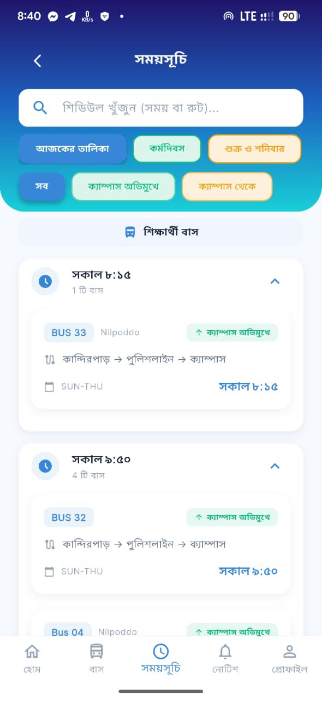
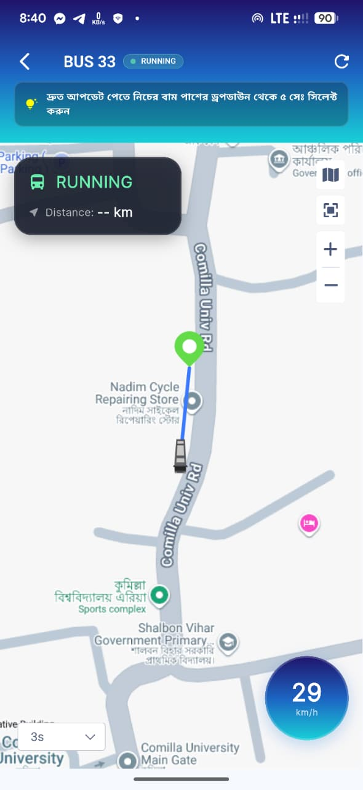
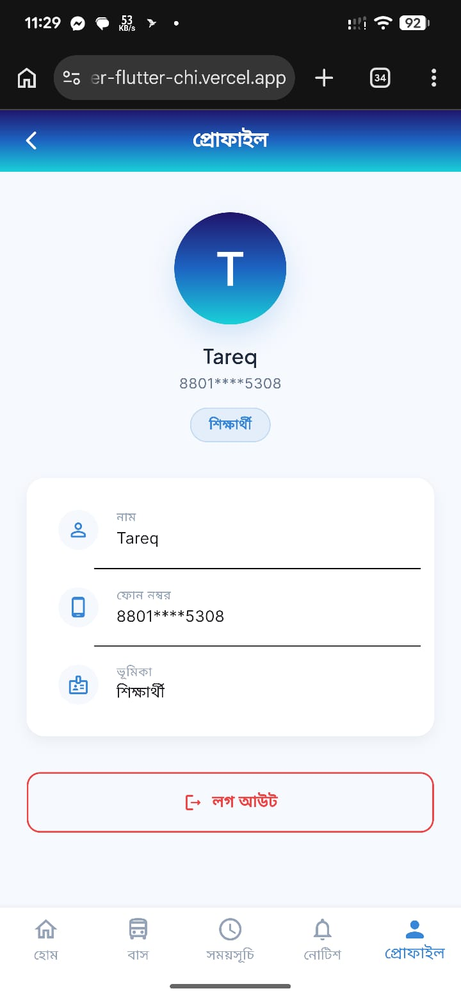
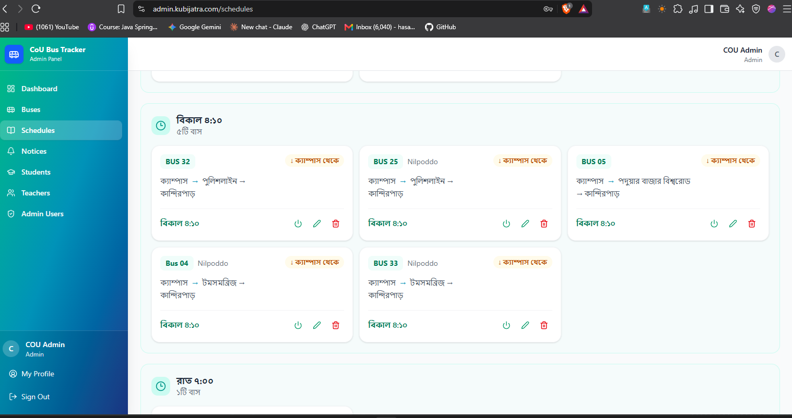
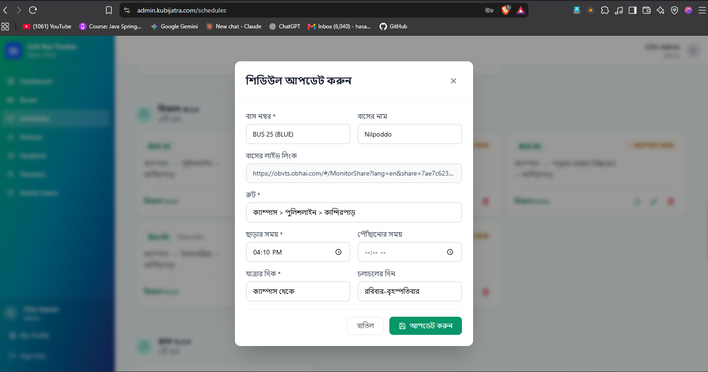

# CoU Bus Tracker — Backend

The production backend for **Kubi Jatra**, Comilla University's bus information and management platform. This folder contains the Spring Boot API, PostgreSQL migrations, Docker deployment files, and the app/admin screenshots used to document the project.

## Production deployment

The API is hosted on the VPS at **[api.kubijatra.com](https://api.kubijatra.com)**. Nginx proxies the public hostnames to the Spring Boot service at `127.0.0.1:8080`.

| Hostname | Purpose |
|---|---|
| [api.kubijatra.com](https://api.kubijatra.com) | REST API |
| [admin.kubijatra.com](https://admin.kubijatra.com) | Admin panel hostname |
| [super.kubijatra.com](https://super.kubijatra.com) | Super-admin hostname |
| [app.kubijatra.com](https://app.kubijatra.com) | App hostname |
| [kubijatra.com](https://kubijatra.com) | Main domain |

According to the deployed Nginx configuration, these hosts proxy to the API on port `8080`. The web panel source code is in `admin-panel/` and `../super_admin/`; panel hosting/build configuration is maintained separately from this API container.

### VPS services

- `docker-compose.prod.yml` builds and runs the Spring Boot API with host networking, so Nginx can reach `127.0.0.1:8080`.
- `docker-compose.postgres.yml` runs PostgreSQL as a separate service, bound to `127.0.0.1:5432` and backed by a named Docker volume.
- Flyway applies SQL migrations when the API starts. The API deployment does not recreate the PostgreSQL service or its data volume.
- `uploads/` is mounted into the API container. Image uploads use Cloudinary when configured.

### Deploy the API

Run these commands on the VPS. The production environment file must already exist at `Backend/.env.production` and contain the correct production secrets.

```bash
ssh root@kubijatra
cd /opt/cou-bus-tracker
git pull origin main
cd Backend
docker compose -f docker-compose.prod.yml up -d --build
docker compose -f docker-compose.prod.yml ps
docker logs --tail 100 -f cou-bus-tracker-app
```

PostgreSQL is managed separately; start or inspect it from `Backend/` with:

```bash
docker compose -f docker-compose.postgres.yml up -d
docker compose -f docker-compose.postgres.yml ps
docker logs --tail 100 cou-bus-tracker-postgres
```

Check the API directly and through Nginx:

```bash
curl -fsS http://127.0.0.1:8080/api/buses
curl -fsS https://api.kubijatra.com/api/buses
```

### Production configuration

`docker-compose.prod.yml` reads `Backend/.env.production`. Keep this file private and out of version control. The important settings include:

| Variable | Purpose |
|---|---|
| `DB_NAME`, `DB_USERNAME`, `DB_PASSWORD` | PostgreSQL container initialization |
| `SPRING_DATASOURCE_URL`, `SPRING_DATASOURCE_USERNAME`, `SPRING_DATASOURCE_PASSWORD` | API database connection; credentials must match PostgreSQL |
| `SPRING_PROFILES_ACTIVE=prod` | Activates production Spring configuration |
| `JWT_SECRET`, `JWT_EXPIRATION` | JWT signing and token lifetime |
| `CLOUDINARY_CLOUD_NAME`, `CLOUDINARY_API_KEY`, `CLOUDINARY_API_SECRET` | Image storage |
| `BULKSMSBD_API_KEY`, `BULKSMSBD_SENDER_ID`, `SMS_ALLOW_SOFT_FAIL` | OTP SMS delivery behavior |
| `GOOGLE_OAUTH_CLIENT_ID` | Google sign-in token verification |
| `MAILERSEND_FROM_EMAIL` and SMTP settings | Transactional email |
| `TZ` | Container timezone, normally `Asia/Dhaka` |

Set a unique, high-entropy production JWT secret. Keep the PostgreSQL port private; the Compose file binds it to localhost. On Linux, ensure the API container can resolve `host.docker.internal` to the VPS host because the production datasource URL uses that hostname.

### Database backup

Create the backup directory and run `pg_dump` using the PostgreSQL container's configured credentials:

```bash
mkdir -p /opt/cou-bus-tracker/Backend/backups
docker exec cou-bus-tracker-postgres sh -c 'pg_dump -U "$POSTGRES_USER" "$POSTGRES_DB"' \
  > "/opt/cou-bus-tracker/Backend/backups/cou-bus-tracker-$(date +%Y%m%d-%H%M%S).sql"
```

Protect backups, copy them off the VPS, and verify restore procedures periodically. Back up before deploying schema-changing migrations.

## Project structure

```text
Backend/
├── src/
│   ├── main/
│   │   ├── java/com/cou/bustracker/    # Controllers, services, entities, security, repositories
│   │   └── resources/
│   │       ├── application*.yaml       # Local, Docker, production, and hosted profiles
│   │       └── db/migration/           # PostgreSQL Flyway migrations
│   ├── test/                           # Backend tests
│   └── kubi_jatra_images_api/          # App and admin UI screenshots for this README
│       ├── about_us_page.jpeg
│       ├── admin_bus_list.png
│       ├── admin_dashboard.png
│       ├── admin_notice_page.png
│       ├── admin_schedule_page_1.png
│       ├── admin_schedule_page_2.png
│       ├── admin_schedule_update.png
│       ├── bus_details_page.jpeg
│       ├── bus_location_view.jpeg
│       ├── bus_schedule_page.jpeg
│       ├── home_page.jpeg
│       ├── otp_page.jpeg
│       ├── profile_page.jpeg
│       ├── splash_page.jpeg
│       └── kubi_jatra_images_api/      # Nested copy of the image set
├── admin-panel/                        # React + Vite admin panel
├── docker-compose.yml                  # Local API + PostgreSQL
├── docker-compose.prod.yml             # Production API service
├── docker-compose.postgres.yml         # Production PostgreSQL service
├── Dockerfile
├── .env.example                        # Local environment template
└── pom.xml
```

The nested `src/kubi_jatra_images_api/kubi_jatra_images_api/` directory currently contains a second copy of the screenshots. The gallery below uses the files directly inside `src/kubi_jatra_images_api/`.

## App and panel screenshots

These screenshots are stored in `src/kubi_jatra_images_api/` and render directly on GitHub:

### Mobile app

| Home | Bus schedules |
|---|---|
|  |  |

| Bus details | Bus location |
|---|---|
|  |  |

| Phone OTP | User profile |
|---|---|
|  |  |

| Splash screen | About the app |
|---|---|
|  |  |

### Admin panel

| Dashboard | Bus list |
|---|---|
|  |  |

| Notices | Schedule list |
|---|---|
|  |  |

| Schedule details | Update schedule |
|---|---|
|  |  |

## Technology stack

| Area | Technologies |
|---|---|
| Backend | Java 21, Spring Boot 3.3.2, Spring Web, Spring Security, Spring Data JPA, Bean Validation |
| Authentication | JWT (JJWT), BCrypt password hashing |
| Database | PostgreSQL 16, Flyway, HikariCP |
| API docs | Springdoc OpenAPI / Swagger UI |
| Image storage | Cloudinary |
| OTP and email | BulkSMSBD, Spring Mail / MailerSend SMTP |
| Admin UI | React, Vite, Tailwind CSS |

## Run locally

Requirements: Docker with Compose. For a source-based backend run, install JDK 21, Maven 3.8+, and PostgreSQL. For the web panel, install Node.js and npm.

### Start API and PostgreSQL with Docker

```bash
cd Backend
cp .env.example .env
# Set a local DB_PASSWORD and JWT_SECRET in .env
docker compose up -d --build
```

The API is available at `http://localhost:8081`; the local Compose database is exposed at `localhost:5433`. This local stack uses a persistent named volume. `docker compose down` preserves it; `docker compose down -v` removes it.

```bash
docker compose logs -f app
docker compose ps
```

### Run the API from source

Configure PostgreSQL for the `dev` profile, then run:

```bash
cd Backend
mvn spring-boot:run
```

The source-run API listens on `http://localhost:8080` by default. Flyway applies migrations when the application starts.

### Run the admin panel

```bash
cd Backend/admin-panel
npm install
npm run dev:local
```

The `dev:local` script configures the panel for a locally running backend. Build the panel with `npm run build`.

## Configuration and migrations

Spring configuration is in `src/main/resources/application*.yaml`. Local development uses `application-dev.yaml`; local Docker uses `application-docker.yaml`; the VPS API uses `application-prod.yaml`.

For local Docker, copy `.env.example` to `.env` and set database credentials and a long JWT secret. Do not commit real credentials. Production secrets belong in `.env.production` on the VPS.

Flyway migration files are in `src/main/resources/db/migration/`. Add a new versioned SQL migration for schema changes. Production disables Hibernate schema generation and applies migrations during API startup.

## API overview

The public API base URL is `https://api.kubijatra.com`. API groups include:

- Public bus, schedule, notice, app version, and public configuration endpoints.
- Student and teacher registration, OTP verification, login, and profile endpoints.
- JWT-protected admin management for buses, tracker links, schedules, notices, students, teachers, and admin users.
- Separate super-admin authentication and management endpoints.

OpenAPI JSON is configured at `/api-docs`; Swagger UI is configured at `/swagger-ui.html`. Whether these routes are accessible depends on the active Spring Security configuration.

## Security notes

- Never commit `.env`, `.env.production`, private keys, or database backups.
- Use strong, unique production values for `JWT_SECRET`, database passwords, and external-service credentials.
- Set `SMS_ALLOW_SOFT_FAIL=false` in production if an OTP must not be accepted when SMS delivery fails.
- PostgreSQL should stay bound to localhost; only expose the required HTTPS web traffic through Nginx.
- Review database migrations and create a backup before a schema-changing production release.

## Related project documentation

- [Repository overview](../README.md)
- [VPS project structure and deployment notes](../VPS_PROJECT_STRUCTURE.md)
- [Admin panel README](admin-panel/README.md)
- [Super-admin panel README](../super_admin/README.md)
