<div align="center">

# 🚌 CoU Bus Tracker (CoU Jatra)

### 🎓 Comilla University Transport Management System

**A real-time bus tracking and transport management platform for Comilla University students, teachers, and staff.**

Built with a Flutter mobile client, a Spring Boot REST API, and a web-based admin panel.


</div>

---

## 📱 App Screenshots

<table>
  <tr>
    <th>🚀 Splash &amp; Cold-Launch</th>
    <th>🏠 Home Dashboard</th>
    <th>🗓️ Bus Schedules</th>
    <th>🚌 Bus Details</th>
  </tr>
  <tr>
    <td align="center"></td>
    <td align="center">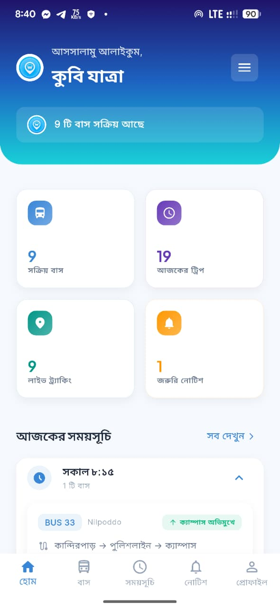</td>
    <td align="center"></td>
    <td align="center">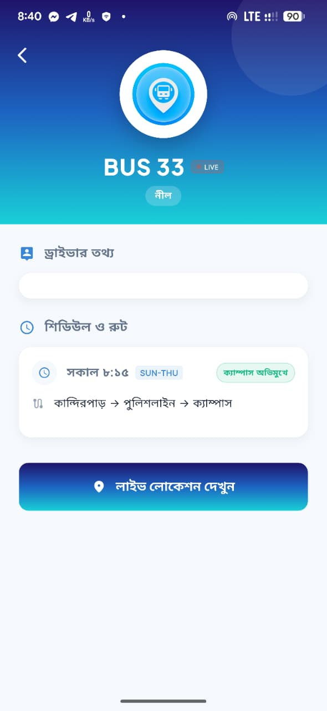</td>
  </tr>
  <tr>
    <td align="center">Splash screen &amp; server warmup</td>
    <td align="center">Live dashboard</td>
    <td align="center">Daily bus schedules</td>
    <td align="center">Route and bus information</td>
  </tr>
</table>

<table>
  <tr>
    <th>📍 Live GPS Tracking</th>
    <th>🔐 Phone OTP Verification</th>
    <th>👤 User Profile</th>
    <th>ℹ️ About &amp; Credits</th>
  </tr>
  <tr>
    <td align="center"></td>
    <td align="center"></td>
    <td align="center"></td>
    <td align="center">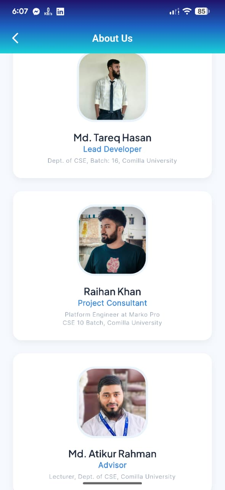</td>
  </tr>
  <tr>
    <td align="center">Track buses on the map</td>
    <td align="center">Verify a phone number securely</td>
    <td align="center">Manage account details</td>
    <td align="center">Project team and credits</td>
  </tr>
</table>

## 🖥️ Admin Panel Screenshots

<table>
  <tr>
    <th>📊 Dashboard</th>
    <th>🚌 Bus Management</th>
    <th>📢 Notice Management</th>
  </tr>
  <tr>
    <td align="center">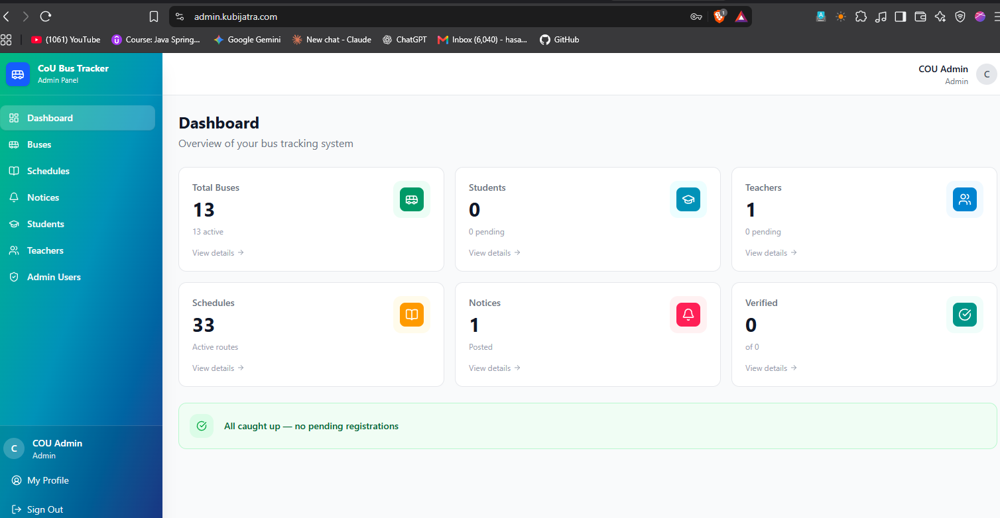</td>
    <td align="center">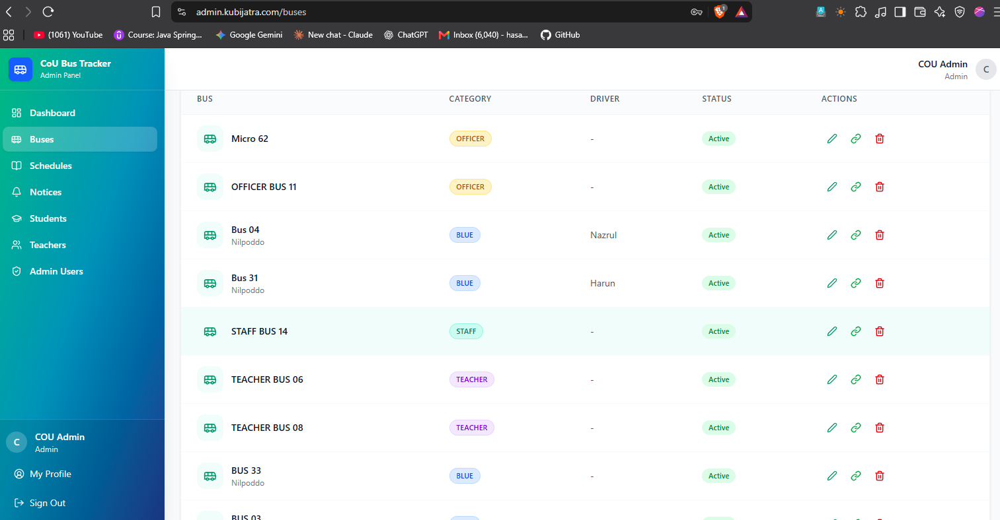</td>
    <td align="center">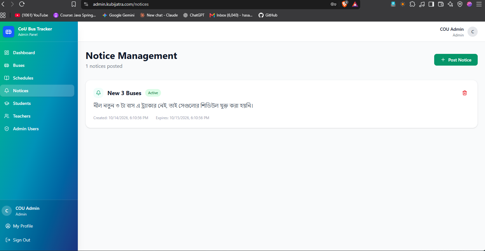</td>
  </tr>
  <tr>
    <td align="center">Transport overview and statistics</td>
    <td align="center">Manage buses and tracker links</td>
    <td align="center">Publish service notices</td>
  </tr>
</table>

<table>
  <tr>
    <th>🗓️ Schedule List</th>
    <th>🕒 Schedule Details</th>
    <th>✏️ Update Schedule</th>
  </tr>
  <tr>
    <td align="center">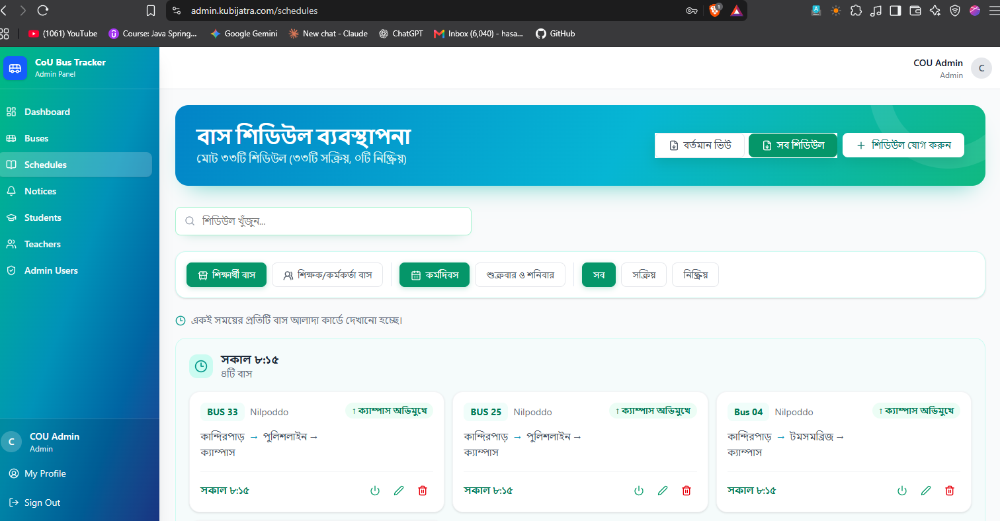</td>
    <td align="center"></td>
    <td align="center"></td>
  </tr>
  <tr>
    <td align="center">Browse and filter schedules</td>
    <td align="center">Review route timings</td>
    <td align="center">Edit route and departure details</td>
  </tr>
</table>

## 🧭 System Diagrams

The diagrams are shown after the app and admin screenshots. Original image files are in [`kubi_jatra_images_api/`](kubi_jatra_images_api/).

<p align="center"><strong>System Context Diagram</strong><br>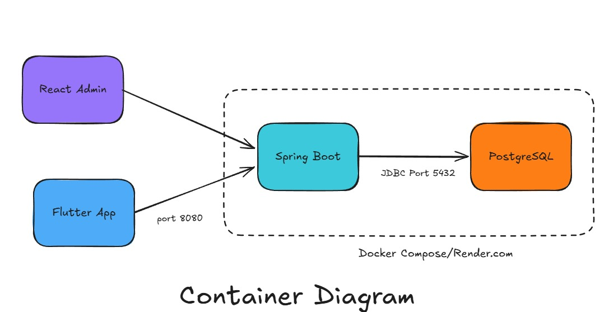</p>

<p align="center"><strong>Container Diagram</strong><br></p>

<p align="center"><strong>Component Diagram</strong><br>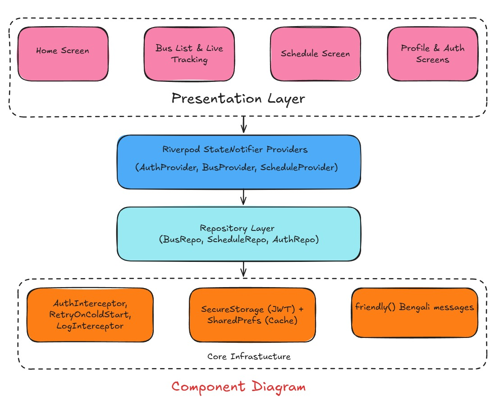</p>

<p align="center"><strong>Backend Architecture</strong><br>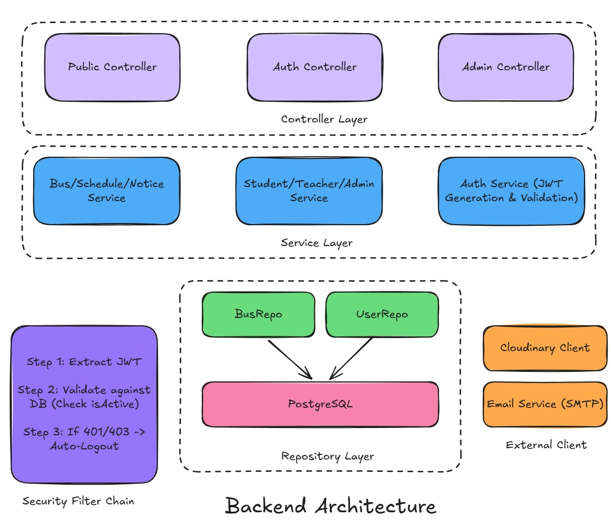</p>

<p align="center"><strong>Data Flow Diagram</strong><br>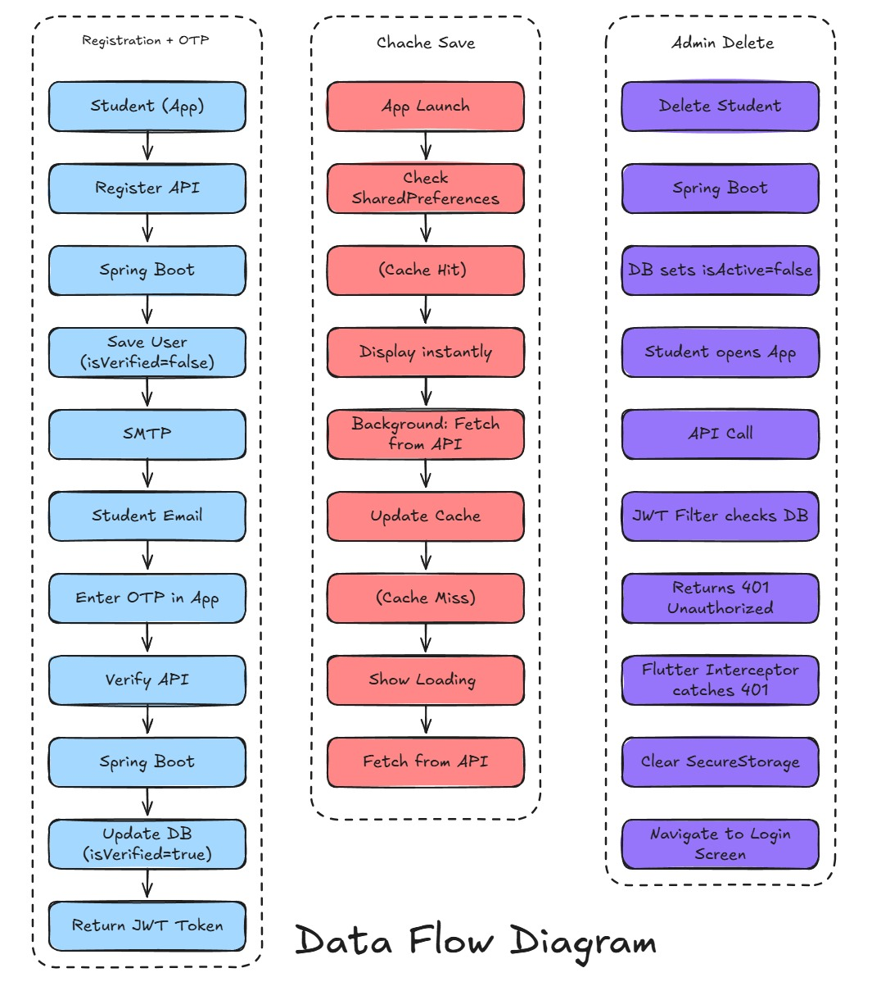</p>

---

## 📖 Contents

- [✨ Features](#-features)
- [🧩 System overview](#-system-overview)
- [🗂️ Project structure](#️-project-structure)
- [⚙️ Technology stack](#️-technology-stack)
- [🚀 Run locally](#-run-locally)
- [🌐 Production deployment](#-production-deployment)
- [🔌 API overview](#-api-overview)
- [🔐 Security](#-security)

## ✨ Features

### 📱 Mobile app

- Browse buses, routes, schedules, and university transport notices.
- View live bus tracking links and bus details.
- Student and teacher accounts with phone OTP verification.
- Profile management and app configuration/version checks.
- Bengali-first interface for the Comilla University community.

### 🖥️ Admin panel

- Dashboard with transport and account statistics.
- Manage buses, tracker links, schedules, and notices.
- Review student and teacher accounts and verification status.
- Manage administrator accounts and profiles.

### ⚙️ Backend platform

- Spring Boot REST API with public and authenticated endpoints.
- JWT authentication with role-based access for students, teachers, admins, and super admins.
- PostgreSQL persistence with versioned Flyway migrations.
- Cloudinary image storage, BulkSMSBD OTP delivery, and SMTP email integration.
- OpenAPI documentation through Springdoc.

## 🧩 System overview

| Component | Technology | Local address | Production address |
|---|---|---|---|
| REST API | Java 21 · Spring Boot · Spring Security · JPA · PostgreSQL | `http://localhost:8080` (source) / `http://localhost:8081` (Docker) | [api.kubijatra.com](https://api.kubijatra.com) |
| Admin panel | React · Vite · Tailwind CSS | `http://localhost:5173` | [admin.kubijatra.com](https://admin.kubijatra.com) |
| Super-admin routes | Spring Boot API | API route under `/api/super-admin` | [super.kubijatra.com](https://super.kubijatra.com) |
| Mobile app | Flutter · Dart · Riverpod | Android/iOS client | [app.kubijatra.com](https://app.kubijatra.com) |
| Main domain | Nginx reverse proxy | — | [kubijatra.com](https://kubijatra.com) |

The current Nginx configuration proxies the listed public hosts to the API at `127.0.0.1:8080`. The app client is maintained separately; this repository includes its API integration and screenshots.

## 🗂️ Project structure

```text
.
├── admin-panel/                         # React + Vite administrator interface
├── kubi_jatra_images_api/                # App, admin, and architecture images for this README
│   ├── splash_page.jpeg
│   ├── home_page.jpeg
│   ├── bus_schedule_page.jpeg
│   ├── bus_details_page.jpeg
│   ├── bus_location_view.jpeg
│   ├── otp_page.jpeg
│   ├── profile_page.jpeg
│   ├── about_us_page.jpeg
│   ├── admin_*.png
│   └── *_diagram.jpeg / backend_architecture.jpeg
├── src/
│   ├── main/java/com/cou/bustracker/     # Controllers, services, entities, repositories, security
│   ├── main/resources/                   # Spring profiles and application configuration
│   ├── main/resources/db/migration/      # PostgreSQL Flyway migrations
│   └── test/                             # Backend tests
├── docker-compose.yml                    # Local API + PostgreSQL
├── docker-compose.prod.yml               # Production API service
├── docker-compose.postgres.yml           # Separate production PostgreSQL service
├── Dockerfile
└── pom.xml
```

## ⚙️ Technology stack

| Area | Technologies |
|---|---|
| API | Java 21, Spring Boot 3.3, Spring Web, Spring Security, Spring Data JPA, Bean Validation |
| Auth | JWT (JJWT), BCrypt password hashing |
| Database | PostgreSQL 16, Flyway, HikariCP |
| Admin UI | React, Vite, React Router, Tailwind CSS |
| API docs | Springdoc OpenAPI / Swagger UI |
| Integrations | Cloudinary, BulkSMSBD, MailerSend SMTP, Google sign-in token verification |

## 🚀 Run locally

Requirements: Docker with Compose. To run the API directly, install JDK 21, Maven 3.8+, and PostgreSQL. The admin UI requires Node.js and npm.

### Start API and PostgreSQL with Docker

```bash
cp .env.example .env
# Set a local DB_PASSWORD and JWT_SECRET in .env
docker compose up -d --build
```

The API is available at `http://localhost:8081`; the local database is exposed at `localhost:5433`. Flyway applies migrations at startup.

```bash
docker compose logs -f app
docker compose ps
```

### Run the API from source

Configure PostgreSQL for the `dev` profile, then run:

```bash
mvn spring-boot:run
```

The source-run API listens at `http://localhost:8080` by default.

### Run the admin panel

```bash
cd admin-panel
npm install
npm run dev:local
```

Build the admin panel with `npm run build` from `admin-panel/`.

## 🌐 Production deployment

The API runs on the VPS behind Nginx. The production Compose file runs the API with host networking on port `8080`; PostgreSQL is a separate Compose service bound to `127.0.0.1:5432` with a persistent Docker volume.

### Deploy the API

The production `.env.production` file must be present at the repository root on the server. Keep it private and out of version control.

```bash
ssh root@kubijatra
cd /opt/cou-bus-tracker
git pull origin main
docker compose -f docker-compose.prod.yml up -d --build
docker compose -f docker-compose.prod.yml ps
docker logs --tail 100 -f cou-bus-tracker-app
```

The VPS previously stored the checkout under `/opt/cou-bus-tracker/Backend`. Before deploying this root-level repository layout, move the production `.env.production` file to `/opt/cou-bus-tracker/.env.production` and preserve any local `uploads/` data. Keep the existing PostgreSQL Compose project name/volume when operating the database so an update does not create a new empty volume.

### Database backup

Create backups on the VPS and keep a protected copy off-server:

```bash
mkdir -p /opt/cou-bus-tracker/backups
docker exec cou-bus-tracker-postgres sh -c 'pg_dump -U "$POSTGRES_USER" "$POSTGRES_DB"' \
  > "/opt/cou-bus-tracker/backups/cou-bus-tracker-$(date +%Y%m%d-%H%M%S).sql"
```

Flyway migrations run at application startup. Back up the database before schema-changing releases.

## 🔌 API overview

Production API base URL: **`https://api.kubijatra.com`**.

| API group | Examples |
|---|---|
| Public data | Buses, schedules, notices, app version, public configuration |
| Student/teacher auth | Registration, phone OTP verification, login, profile |
| Admin | Buses, tracker links, schedules, notices, students, teachers, admin accounts |
| Super admin | Super-admin authentication, app configuration, management routes |

Springdoc is configured to serve OpenAPI JSON at `/api-docs` and Swagger UI at `/swagger-ui.html`. Access depends on the active Spring Security configuration.

## 🔐 Security

- Keep `.env`, `.env.production`, database backups, and private credentials out of Git.
- Use unique production values for `JWT_SECRET`, database passwords, and external-service keys.
- Set `SMS_ALLOW_SOFT_FAIL=false` in production when OTP delivery must be enforced.
- Keep PostgreSQL bound to localhost and expose web traffic through HTTPS/Nginx.
- Do not use `docker compose down -v` on the production database stack; it removes its named data volume.

---

<div align="center">

Made for **Comilla University** 🎓 · **Kubi Jatra** 🚌

</div>
